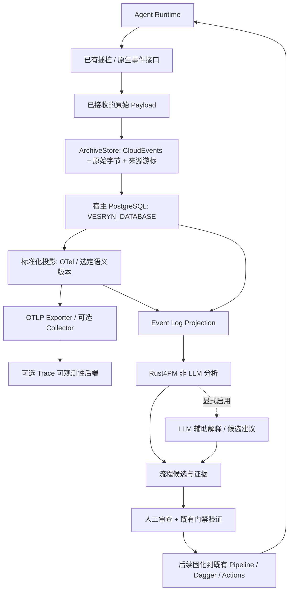

# Trace-Driven Workflow Optimization Loop — 实施方案

本文保留 pre-0.6.0 的设计范围、架构边界和交付步骤。前期代码已随 PR #20 合并，未正式发布 0.6.0；本轮按用户确定的 v0.5.5 过渡版本交付两个 P0 与 Rust4PM 调整。各阶段按下文实施；已完成证据见[原始轨迹验收](../../verification/trace-validation.md)。
基线为正式 v0.5.4，提交 `f1d7d31014417468fa7299be27a86f0a57b47521`。
P0-0 至 P0-4 已实现并获得分阶段实测证据，版本元数据在功能 PR 交付前统一准备。
归档存储复用本地宿主 PostgreSQL，由 `VESRYN_DATABASE` 提供连接配置；不保留 SQLite 后端或回退。

## 版本升级依据

v0.6.0 的新增公开能力是：将实际 Agent 操作归档为可回放的证据，
并基于同一份证据提供不依赖 LLM 的离线流程分析。
它使 engineering-ci 从调用既定检查和交付流程，开始具备观察执行历史、
分析流程变体并提出改进候选的能力。安装 OTel、增加数据库或定义新概念本身不构成完成依据。

[SemVer](https://semver.org/) 对 0.y.z 阶段不承诺稳定公开 API。
本项目仍应保持已有检查、下载、恢复和发布契约；用 0.6.0 标识新增的能力域，
而不是借版本变化破坏现有消费者。补丁版本继续用于该能力域内的正确性修复。

v0.6.0 不应声称整个自动优化循环已经实现。最低交付范围为：

1. 一个真实支持的数据来源，来源能力和限制经过实录核对。
2. 保留原始字节的归档、幂等导入、恢复导入与回放。
3. CloudEvents 封装与少量归档元数据；来源完整性可以解释。
4. 复用标准 OTel 数据模型及成熟插桩；支持范围内的数据可以重新生成标准化视图。
5. 同一固定数据集的非 LLM 变体分析；具备适当事件顺序和时间信息的数据可调用 Rust4PM 发现 DFG。
6. 分析结果可追溯到原始事件，并明确未支持、未知或缺失的信息。

跨运行优化效果验证、LLM 辅助建议、Workflow IR 及编译器属于后续阶段，
不能用尚未实施的加分目标替代上述验收。范围已按本方案确定，代码和四处版本元数据在同一个功能 PR 交付。

## 现有系统与新能力的关系

已有[CLI 边界](../cli-boundaries.md)、[本地检查](../local-checks.md)、
[执行恢复](../execution/state-and-recovery.md)和[发布机制](../release/workflow.md)继续有效。

- FSM、Pipeline 与 `ExecutionContext` 管理实际执行及证据准入。
- `OperationResult` 是操作结果视图，不是历史事件存储。不能把它的最终快照当成完整轨迹。
- 轨迹引用既有检查身份、输入摘要、Commit、PR、Run 与 Attempt；不重新维护另一套执行事实。
- OTel 的上下文传播不等于业务 `ExecutionContext`，两者通过既有操作身份关联。
- 轨迹不参与 GitHub 发布资格判断，也不把历史成功结果直接变成本轮检查通过。
- PostgreSQL 存放观察数据，不替代 JSON StateStore，不用事件回放重建或推进业务 FSM。
- GitHub Actions 继续管理远端 Job DAG、权限和 Artifact；Dagger 继续管理容器内执行及其 DAG。

轨迹分析可以指出重复测试、失败恢复或等待成本，但不能自动省略测试、绕过人工合并，
或把 Dispatch UNKNOWN 当成可以重试的证据。

## 标准与成熟实现的复用

| 边界 | 优先复用 | engineering-ci 需要做的工作 |
| --- | --- | --- |
| SDK / 框架调用插桩 | OpenTelemetry / OpenInference 已有 instrumentation | 选择实际适配的包、配置内容采集与出口，验证覆盖范围 |
| 运行时原生事件 | Codex 已公开的 JSONL 或 App Server 接口、已有 SDK 导出 | 接入显式来源；缺少原生支持时才增加薄适配 |
| Trace / Span / Log 模型 | OTel、OTLP、版本固定的语义约定 | 关联既有执行身份；处理来源到标准模型的实际缺口 |
| 传输、重试、可观测性 | OTel exporter / 可选 Collector、既有后端 | 配置和兼容性验证，不自建 Collector 或 Trace UI |
| 原始归档 | 宿主 PostgreSQL、Psycopg 3、CloudEvents | 实现归档索引、来源游标及字节回放；复用服务器事务与持久性机制 |
| 流程发现与一致性分析 | Rust4PM | 定义 case、活动粒度、入选数据和分析身份 |
| 工作流执行 | 既有注册 Handler、Pipeline、Dagger、Actions | 后续只把经过审查的候选接到现有执行边界 |

[OpenTelemetry Python GenAI](https://github.com/open-telemetry/opentelemetry-python-genai)
已有 OpenAI 和 OpenAI Agents 等插桩。旧 contrib 包已有迁移提示，
选型时核对当前包、受支持 SDK 范围和锁定版本，不照抄旧安装示例。
成熟插桩能覆盖的 SDK 生命周期、流式响应和 token 使用量，不另写包装器。

只在同一采集范围选一套主插桩，防止 Agents SDK、模型 SDK、OpenInference 和 OTel
重复统计同一次模型调用。底层 HTTP Span 可以保留，但不作为第二次模型调用或收费事件。

[OpenInference](https://arize-ai.github.io/openinference/spec/) 使用 OTel 数据模型。
以选定版本的 OTel + GenAI 约定为主；特定来源或后端需要 OpenInference 时，
保留其来源语义并建立显式映射，不把两套不同含义的属性当成天然同义词。
[GenAI 约定](https://github.com/open-telemetry/semantic-conventions-genai/tree/main/docs/gen-ai)
当前仍标为 Development，因此标准化视图必须记录所用版本。

Codex 是独立运行时，给 Python OpenAI SDK 插桩不等于覆盖桌面 Codex。
[Codex JSONL](https://learn.chatgpt.com/docs/non-interactive-mode)与
[App Server](https://learn.chatgpt.com/docs/app-server)提供公开事件接口；
选用哪个来源需要实际核对事件、可恢复游标、时间信息和使用量。
不能因 SDK 有插桩就声称已获得某个桌面会话的完整 Trace。

## 已确定的实现边界

| 容易混淆的组合或推论 | 实施约束 |
| --- | --- |
| CloudEvents → Collector → 数据库可以直接串起来 | CloudEvents 是事件封装，OTLP 是遥测传输；必须核对现成 receiver/exporter 是否匹配。PostgreSQL 原始归档与 Collector 遥测传输分属两条路径 |
| Collector 持久化队列就是长期原始归档 | 队列解决传输重试，可能已处理、截断或采样；长期归档应位于这些操作之前 |
| 来源原始字节永久不修改，同时默认公开完整输入输出 | 字节不变不代表允许收集或传播敏感内容。原始归档显式启用、受限访问；分析与导出使用经过策略处理的派生数据 |
| Trace 结束就说明事件 complete | 结束只证明边界被观察到；是否缺事件必须根据来源协议判断，无法判断时为 unknown |
| 所有 Span 按时间排序就是流程顺序 | 并发、跨进程时钟和传输乱序使该推论不成立；保留因果关系和并行关系 |
| 一个 Trace ID 就是一个完整交付 case | Trace 常对应一次调用，开发交付可跨多次调用、人工停点及多个 Actions Attempt；case 必须单独定义 |
| Rust4PM 发现的图就是可执行 Pipeline | 发现的是历史行为模型，不含可信权限、依赖准入或重试安全性，需要候选审查和验证 |
| 重复调用就是可删除步骤 | 可能是失败恢复、输入变化、不同环境或显式负向测试；必须结合检查身份与执行结果 |

[Collector 的持久化发送队列](https://opentelemetry.io/docs/collector/resiliency/)
可用于可靠传输，但不能据此承诺原始数据长期保留或端到端无丢失。

## 抽象架构

这是职责图，不表示已实现所有节点。已有 OTel 来源的标准化可以直接复用原生 OTLP，
不必再映射一次。日志、指标和 Span 各保留原生信号类型，不把所有数据强制转为 Span。
本地回放和流程分析应能脱离 Collector、Phoenix、LangSmith 或 Jaeger 工作。
线上可观测性出口只消费归档的派生数据，不成为回放的唯一来源。

稳定的代码边界如下；只为实际接入的来源实现模块，不创建空后端：

| 边界 | 负责 | 不负责 |
| --- | --- | --- |
| Source adapter | 读取显式选定的原生来源，声明覆盖能力、标识、游标及结束条件 | 重写成熟插桩、推断不可见操作 |
| ArchiveStore | 原始字节、封装、去重、事务、导入恢复、不可变快照 | 网络调度、Span 语义、FSM 状态 |
| Projection | 来源到标准 Trace / Event Log 的版本化投影、完整性解释 | 修改原始归档、补造事件或时间 |
| Mining | 调用 Rust4PM、记录分析输入及候选依据 | 执行候选、修改门禁、发起远端副作用 |

代码放 `src/engineering_ci/tracing/` 与 `src/engineering_ci/mining/`。
用户操作接到已有 `engineering-ci` CLI；`scripts/` 继续只有 release.py、download.py。
Workflow 固化使用既有执行模块，暂不增加另一套调度器、插件注册系统或配置语言。

## 三层数据与少量元数据

### 原始 Payload

保留来源已交付的 JSONL 行、JSON 文件或 OTLP 字节；归档与回放之间按字节比较和摘要验证。
“不修改”包括不重新序列化 JSON、不丢弃未知字段、不把不支持的事件静默过滤掉。
来源已经做过脱敏、截断或采样时，记录这个事实，不能声称获得脱敏前原始内容。

JSONL 截断尾行和格式错误可归档为原始字节及解析诊断，不伪造一个完成事件。
归档回放只重新读取数据，绝不重新执行历史工具调用。

### CloudEvents 封装

按 [CloudEvents 1.0.2](https://github.com/cloudevents/spec/blob/v1.0.2/cloudevents/spec.md)
使用 `specversion="1.0"`，保留 `source`、`id`、`type` 等标准字段。
`source + id` 是去重身份，不是 payload hash：相同调用可以产生相同内容但属于不同事件。
原生事件无 ID 时，可用来源会话/流身份与真实记录位置稳定生成，不按导入时间重新编号。

原始字节存放在 PostgreSQL `bytea`，CloudEvents 属性使用 `jsonb`；
`jsonb` 不承担原始字节保真。对外 CloudEvents JSON 使用标准 `data_base64` 表达二进制内容。
直接把解析后的 JSON 填入 `data` 不足以保留原始序列化字节。
不把任意 OTLP 批次误称为单个工具事件；批次中多个 Span 的来源关联由投影建立。

只增加必要归档信息：来源格式/生产者版本、流标识、真实游标/记录位置、接收时间、
payload 大小与摘要、采集范围/能力及策略版本。扩展属性名遵守 CloudEvents 命名规则。
源事件没有时间时，不把接收时间冒充标准 `time` 的发生时间。
少量索引和版本字段不等于自定义完整 Agent Trace Schema。

### 标准化 Trace 与分析投影

使用标准 OTel Resource / Scope / Span / Event / Link、OTLP 表达及可用的标准属性。
原生 Trace/Span/Parent/Tool Call ID 优先保留；跨进程、恢复和多父因果关系采用可解释的关联与 Links。
没有时间信息时不伪造开始/结束时间来满足 Span 或 Rust4PM API；保留为可关联的原始事件，
或选择允许仅使用实际顺序的分析。缺失时间的时长分析明确不可用。

每个投影能定位到原始事件，记录投影实现、语义约定和相关配置版本。
同一原始快照可以生成不同投影，新版本不得覆盖旧投影的身份。
保留不能映射的字段、原因和数量；标准化成功与采集完整是两个不同结论。

## 身份、完整性与实际结果

需要区分来源会话/线程、turn、工具调用、OTel Trace/Span、业务交付 case 和执行 attempt。
它们可以关联，但不能共享一个字段来表达所有身份。
Commit SHA 不覆盖未提交修改；跨阶段关联仍使用已有输入摘要和检查身份。
同一 Actions Run 重跑时保留不同 Attempt，不合并成一次通过。

首次挖掘的 case 是一次明确导出的 Agent turn/执行片段；完整 PR→Merge→Release
链是后续具有显式关联的业务视图，不凭相同仓库、分支或相近时间拼接。
来源不能可靠分段时保留流级统计，不猜测多个独立任务属于同一个 case。

完整性保持三个值，并附判定范围、依据、已知缺口及所用规则：

| 值 | 判定 |
| --- | --- |
| complete | 在声明的采集范围内，来源协议的预期数量/游标/边界证据足以证明已接收预期事件 |
| incomplete | 发现确定缺口，例如序号断裂、已知丢弃、截断、缺失预期完成事件 |
| unknown | 来源没有足够的计数、序列或边界保证，或者仍在采集中，无法确认 |

仅有 `turn.completed`、Root Span 已结束或文件可以解析，不足以证明完整。
一个密封文件可字节完整，但来源可见性仍为 unknown；归档校验与协议完整性分别记录。
失败或取消的执行也可能 complete，成功执行也可能 incomplete。
完整性评估引用不可变快照；迟到事件到达后生成新快照及评估，不修改旧分析依据。

默认分析保留三个组的数量；把 incomplete / unknown 作为单独的探索结果展示。
没有 complete 数据时允许输出带限制的分析，不能把其它两组悄悄升级为 complete。
需要完整证据的优化建议在证据不足时明确不具备验证条件。

## 持久化与恢复

### 连接与配置

使用 [Psycopg 3](https://www.psycopg.org/psycopg3/docs/basic/usage.html)，不自写 PostgreSQL 协议、连接驱动或事务框架。
通过 `os.environ["VESRYN_DATABASE"]` 读取已有宿主连接配置，由 Psycopg/libpq 解析支持的 URI 或 conninfo。
不打印环境变量值，不将其复制到 TOML、状态文件、Trace、测试报告或 Git。
缺失、格式错误、连接失败、认证失败与 schema 权限不足分别返回脱敏诊断；
保留安全错误分类和可用 SQLSTATE，不直接输出可能带连接信息的驱动异常。

非敏感配置单独放在 `config/tracing.toml`：schema 名、批大小、payload 上限、超时、内容策略及来源类型。
连接环境变量名固定为 `VESRYN_DATABASE`，不维护第二份 DSN 来源或默认账号。
首版 schema 为 `engineering_ci_trace`，使用限定 schema 的 SQL 和参数化值。
迁移仅针对该专用 schema，先检查同名已有对象是否属于本组件；不修改其它应用对象、服务器配置或账号权限。
schema 迁移不在 status 查询时隐式执行。

Python 驱动作为轨迹功能的可选依赖并延迟导入，现有 release/download 不要求数据库配置或连接。
缺少驱动或连接配置时报告该功能不可用，不回退 SQLite，不新建服务器，不切换账号绕过权限。
不因本地连接失败而自动启动另一个数据库容器。

### 事务、并发与快照

将原始 `bytea`、CloudEvents 属性、来源元数据和恢复游标写入同一个 PostgreSQL 事务。
[`bytea`](https://www.postgresql.org/docs/current/datatype-binary.html) 用于精确保留原始字节。
只有确认事务提交后才确认游标；提交响应丢失时查询相同来源身份并核对内容，再决定是否需要重送归档记录。
不能借数据库恢复重新执行 Agent 工具、pytest、Dagger 或 GitHub POST。

以 `(source, event_id)` 的唯一约束和
[`ON CONFLICT`](https://www.postgresql.org/docs/current/sql-insert.html) 处理并发重复投递。
相同身份且相同 payload 为重复；相同身份但不同内容为冲突，不用 UPSERT 覆盖原始证据。
必要时核对元数据是否符合同一事件身份，不能只用 payload hash 猜测相同操作。
同一来源游标的并发推进采用事务内锁或比较更新，避免两个 importer 跳过对方尚未提交的区间。
不同来源允许并行写入；设置有限的连接、锁和语句超时，不建立任务调度器或常驻接入服务。
来源导出包含更新版本的同一 Span 时，保留真实导出批次/修订身份，不误报为重复工具执行。

分析读取固定的已提交事件成员集，在一致性事务内生成快照引用与摘要，之后可离线处理。
[PostgreSQL 事务隔离](https://www.postgresql.org/docs/current/transaction-iso.html) 支持一致性读取；
数据库 sequence 的间断不等于来源缺失，分配顺序也不等于提交顺序。
不能用最大自增 ID 代替快照成员集或来源完整性判断。
新增迟到事件生成新快照，不改写旧分析的成员集。

读取并记录实际服务器版本及可核验的持久性设置；不自动修改宿主全局 `fsync` 或 `synchronous_commit`。
事务成功、进程故障恢复、服务器掉电持久性及备份可恢复性分别验收，不因“使用 PostgreSQL”就宣称全部成立。
容量和保留策略只作用于本组件数据；超限明确停止，不截断后仍声称完整。

### 宿主、Dagger 与测试环境

首版由宿主 importer 写归档。Dagger 运行依赖隔离的投影/挖掘测试，并优先接收固定快照，
无需向分析容器传播宿主数据库凭据。需要数据库集成的测试显式配置测试服务和隔离 schema。
GitHub runner 不假定可访问开发机的 PostgreSQL；CI 的测试实例是测试 fixture，不是生产归档后端。
容器连接宿主时不能直接沿用 `localhost`；如确有此需求，单独确认网络与凭据传递，不改写现有 DSN 猜测目标。

本地真实数据库验收使用 `VESRYN_DATABASE` 指向的宿主实例及专用测试 schema。
测试清理只删除已验证归属本次测试的对象，不清空业务 schema。
数据库不可用时将集成验证记录为不可用；必需验收不能以跳过或 Mock 通过代替。
来源游标与业务检查断点分开，回放仅处理归档。

遥测出口可重复投递，系统不承诺端到端 exactly-once。归档入口保证受支持身份的幂等性。
Trace 出口失败不改写原工具的退出码；采集/归档命令自身返回实际失败，避免暗示仍有完整证据。
归档、遥测出口和挖掘操作不再次写入自身采集流；内部观测采用独立范围，避免递归插桩与重复计费。

## Event Log 与 Rust4PM

Event Log 是可重建的分析视图，不是第四套全量 Agent Schema。
当前使用 [Rust4PM Python 绑定 r4pm](https://github.com/aarkue/r4pm) 的 XES、活动投影、variants 和 DFG 接口。
只将准入的 case 与稳定活动名称序列序列化为临时 XES；Rust4PM 完成发现算法。
XES 不包含命令、输出或虚构时间。临时文件和本进程的 Rust 注册对象在调用结束后清理。
顺序准入继续依赖原投影的真实时间和 Turn 边界，不以 XES 行序推导新的因果依赖。
Rust4PM 的边界活动集合没有频次；兼容字段的频次由它返回的变体及 case 数聚合。

同一工具的 started、delta、completed 不计为多次工具调用。首版用完成的操作作为活动，
开始/结束用于顺序准入，delta 留在归档中。失败和取消样本保留，不美化为成功。
缺少边界、无效时间、重叠及并列 case 保留排除原因。DFG 描述观察到的顺序，不直接成为执行依赖。
更复杂的 Process Tree/Petri Net/OCEL 按真实需要加入。

`mining` 仅显式安装 r4pm 0.6.2，不内置 PM4Py，不创建双后端框架。
原先的 PM4Py 集成仅涉及两个本地分析接口；旧的 `observed-turn-variants/1` 结果保留、可登记和查询。
新结果为 `/2`，身份含 engine=rust4pm 和 r4pm 版本，不将两种后端的证据混为同一次执行。
项目没有修改或复制上游算法。[依赖与许可](../../configuration/tracing.md#可选离线挖掘)独立说明。

## 非 LLM 与 LLM 两条输出

非 LLM 路径默认启用：固定快照、映射、过滤及算法配置，输出可追溯的统计和候选证据。
结果标记 `llm_used=false`，不调用模型服务。

LLM 路径显式启用，在同一份非 LLM 结果之上解释或建议，单独输出 `llm_used=true`。
记录输入快照、基础分析摘要、模型/提供者、参数和实际请求身份；不覆盖基础结果。
token/cost 不可获得时为未知，不记为零。LLM 不可用或生成无效建议时，基础分析仍可使用。

[PM4Py 的 LLM 模块（历史方案中的能力示例）](https://github.com/process-intelligence-solutions/pm4py/blob/release/pm4py/llm.py)
同时包含文本抽象和真正的模型查询；调用 `pm4py.llm` 中的格式化函数不一定使用了模型。
`llm_used` 根据实际模型调用判断，不能根据模块名称判断。
不执行 LLM 生成的任意 Python 或 shell；其建议需要经过相同的静态校验和人工审查。

## 分析身份与优化目标

分析身份包括原始事件快照摘要、入选 case/完整性规则、来源范围、活动映射、
语义及投影版本、算法/参数/随机种子、依赖版本和相关环境。
同一身份的核心输出确定；导出时间等非核心字段与核心摘要分开。
输入变化、新增迟到事件、映射或工具版本变化均使旧分析不再代表当前输入。

模型使用量按原生作用域记录，不能将 turn 汇总量再加上它的子模型调用量。
美元费用只有来源提供或有可追溯计价依据时才记录；注明币种、价目依据和估算性质。
等待时长、工具服务时长、恢复次数、模型 token 与费用分别计量。
不把输入缓存 token、Dagger 缓存命中或复用检查等同于新增测试执行。

优化以原有正确性和质量策略保持成立为前提，比较可比数据集的耗时、重复执行与成本。
不能仅凭一次快运行认定有效，也不能通过删除失败、取消或不完整样本美化结果。
记录失败、人工停点、权限拒绝、缓存复用和真正执行的区别。
挖掘提供假设而非根因事实：一次循环可能是错误恢复，而不是低效冗余。

## 工作流候选与固化

候选先保存来源、样本数、流程模型、观察结果、建议变化和未知条件。
自动发现的关系不直接成为生产依赖；业务输入输出、权限、副作用和重试策略仍需要明确声明。

后续 Workflow IR 只覆盖已有注册 Handler 的可表达动作、参数、数据依赖及准入约束。
发现模型可采用后端原生形式，没必要先发明一个通用工作流语言。
没有实际目标需求时，候选报告已足够，不建立空编译器。

固化到 TOML / Dagger / YAML 必须显式拒绝目标无法表达的能力：
GitHub 权限和同一次 Workflow 的 Job DAG 仍由 YAML 决定；
运行时 Python 读取 TOML 不能改变 GitHub 已解析的远端 DAG。
Dagger 执行实际容器任务，不持有完整 Agent 开发生命周期。
编译产物作为可审查的代码/配置 diff，经过现有检查并按已授权范围交付。
候选结果不扩大远端操作授权，不绕过人工合并或正式发布边界。

## 实施顺序与阶段验收

首个实际来源为用户授权的单个桌面 Codex 原生 rollout JSONL（生产者 0.162.0-alpha.2），按固定文件前缀离线导入，不再次执行 Agent。该内部格式与公共 codex exec --json 事件流分开；后者不作为导出现有会话的命令。
已有 OTel 数据保留原生形式；其他运行时的在线插桩按实际需求接入成熟实现，首轮不同时建设多个采集后端。格式核对只采样文件开头和末尾，其余 Codex 输出默认可信；归档和挖掘按职责流式处理实际字节，不把采样当成全量检查。
原始归档与非 LLM 分析是 pre-0.6.0 的设计范围；本轮按用户选择以 v0.5.5 过渡交付；LLM、可观测性后端和候选固化不阻塞本轮交付。

| 顺序 | 实施动作 | 完成证据 |
| --- | --- | --- |
| P0-0 宿主与连接 | 读取 VESRYN_DATABASE；使用 Psycopg 做脱敏配置解析、连接及只读版本/schema/权限核对 | 缺配置、认证/网络/权限错误可区分；确认实际目标和专用 schema，未核对前不执行迁移 |
| P0-1 来源能力核对 | 用显式 JSONL 实录核对事件、身份、时间、顺序、终止和内容策略；复用公开协议 | 来源能力表、实录样本、未知字段处理；源缺少信息时明确不可用或 unknown |
| P0-2 PostgreSQL 归档 | 编写专用 schema 迁移及 ArchiveStore，按上述事务、去重、游标与快照契约实现 | 字节回放、回滚/提交响应丢失、强杀/并发/重复/截断/身份冲突测试；宿主 PostgreSQL 真实集成结果 |
| P0-3 标准与完整性 | 复用原生 OTel，补真实缺口；版本化投影和三态完整性 | 同一字节快照可重建；没有足够协议证据时保持 unknown |
| P0-4 基础流程分析 | 调用 Rust4PM，固定 case 和活动映射，输出非 LLM 变体和适用范围内的 DFG | 真实样本分析、确定输出、来源引用；缺时间/并行不伪造顺序或时长 |
| P0-5 CLI 与回归 | 注册统一 CLI 操作，增加必要配置、可选依赖、使用说明及检查范围 | 单项操作可调用；原始退出状态有效；release/download 无数据库依赖；现有 PR 检查和消费者契约不退化 |
| P0-6 同 PR 交付 | 准备四处本轮 v0.5.5 元数据，运行相关检查及现有 PR CI；人工审查合并后按既有机制正式发布 | 代码、版本、检查输入与 PR Commit 一致；正式 Release 使用真实 Run/Attempt/Manifest，未合并不发布 |
| P1 可观测性与评估 | 可选 OTLP / Collector / 一个现成后端，候选与基线比较 | 出口失败不影响原始事实；验证正确性不退化、优化比较条件明确 |
| P2 辅助与固化 | 可选 LLM 第二输出；有实际候选后接入既有 Pipeline / Dagger | 两条输出分开、合法 Handler、可审查 diff、现有门禁与人工边界有效 |

P0 是 pre-0.6.0 核心设计范围。若某项不可实现，应报告阻碍并调整交付范围，
不能把模拟测试通过当成真实采集或闭环优化成功。
各阶段验证其新增行为和受影响契约；身份匹配的已有证据继续复用，不为切换阶段重复执行检查。
不提前连写所有接口和未来空实现。

### 各阶段对应的代码和文档

以下是实施归属，不表示文件已经存在；每阶段仅创建当期实际需要的文件。

| 阶段 | 修改范围 |
| --- | --- |
| P0-0 | `src/engineering_ci/tracing/config.py`、`config/tracing.toml`、可选依赖声明及配置测试；后续通过配置 README 导航到实际配置说明 |
| P0-1 | `tracing/sources/` 中的 Codex JSONL 薄适配；脱敏实录 fixture、来源能力及未知事件测试 |
| P0-2 | `tracing/store.py`、专用 SQL 迁移、归档/回放/恢复测试；保留 ArchiveStore 接口，首版只有 PostgreSQL 实现 |
| P0-3 | `tracing/projection.py`、完整性评估及相应测试；标准语义依赖和投影版本明确锁定 |
| P0-4 | `mining/` 的 Event Log 投影及 Rust4PM 调用；确定性输出和来源追溯测试，所需可选依赖 |
| P0-5 | 既有 CLI 注册点及当期实际 trace/mining 命令；`config/pipeline.toml` 的必要检查范围、指南和配置导航 |
| P0-6 | 两份 `pyproject.toml`、两份 `uv.lock`、同一功能 PR 的说明及实际验证记录 |

P0-0 只做只读预检。P0-2 的迁移操作显式执行，限制在已经确认的专用 schema；
缺权限或目标归属不清时报告需要决定的事项，不自动创建新数据库或移动工作区。

已实现 `engineering-ci trace status/inspect/init/import/replay`；参数见[CLI 参考](../../../guides/cli-reference.md#原始轨迹)。
`engineering-ci trace project` 使用官方 OTel SDK 生成离线 Span JSON；`engineering-ci mine` 已接入显式安装后的 Rust4PM 本地非 LLM 变体和 DFG 分析。
导入以用户给定文件为输入，回放只输出原始数据，分析以固定快照为输入。
既有 `release.py`、`download.py` 的职责不增加轨迹采集或挖掘操作。

迁移采用按版本提交的 SQL，并复用 Psycopg 事务执行；记录本组件 schema 版本和归属。
首版不增加 ORM、常驻服务或数据库任务队列，不为未经证明的吞吐需求增加连接池。
对二进制/JSON/SQL 采用成熟库和参数化接口，不自行实现它们的协议。

在功能 PR 交付前执行既有 `engineering-ci version set v0.5.5`，让版本元数据与实现一同交付。
版本准备不能留到人工合并之后，也不使身份仍匹配的既有检查证据无条件失效。

必须验证的异常还包括：来源重启及文件轮换、未知事件类型、采样/截断、迟到完成事件、
Span 父节点缺失、跨时钟偏差、解析/导出失败、不同 Attempt、运行取消和遥测队列丢弃。
明确区分原始来源已接收字节、标准化覆盖率、流程分析成功以及原任务成功。

Dagger 提供固定依赖的 Linux 分析/测试环境，Windows 验证宿主数据库连接、归档及恢复；
容器测试与宿主 PostgreSQL 集成分别记录。使用显式的测试 schema/实例，测试清理必须验证目标归属。
不把 GitHub CI 配置成访问个人宿主数据库，不将生产连接值放入日志或普通容器环境导出。
新功能要求的数据库集成测试应在现有测试调用中明确配置，缺失 fixture 不记为通过；不建立跨仓库编排。
默认回归不调用付费模型，不触发真实 GitHub Workflow，也不重新执行历史工具。
真实采集、模拟异常、离线算法分析与优化执行的证据分别记录。

## 内容策略、未完成预检与上下文衔接

完整原始归档涉及输入输出和可能的机密，与原有脱敏发布证据是不同的数据范围。
来源、保留期、访问控制与内容策略在第一次实际采集前明确；禁止自动扫描账号全部会话。
原始内容保持不可变，导出可以脱敏；需要清理归档时执行明确的数据保留策略，
不能同时承诺无限保留和删除敏感内容。
清理需核对快照引用；原始成员已按策略删除时，将对应快照标记为不可回放，
不能仅凭保留的摘要继续声称原始字节可用。
按默认策略不导出 prompt、工具参数、环境变量或认证内容。遥测和分析结果不提交 Git。

已确定的选择：宿主 PostgreSQL、`VESRYN_DATABASE`、Psycopg 3、首个来源为显式桌面 Codex rollout JSONL、
成熟插桩优先、默认非 LLM 分析、原始归档与业务执行状态独立。
这些选择不因工具环境缺失而自动换成另一套后端。

仍需在对应步骤实际核对：宿主 PostgreSQL 版本及 schema 权限、当前进程的环境传递、
来源样本的可见性/时间/顺序能力、内容保留期及容量、驱动与分析后端锁定版本及跨平台兼容性。
无法核验的项明确保留未完成，不猜测账号、数据库目标、事件完整性或可用费用。

P0-0 的宿主预检、P0-1 来源适配、P0-2 归档/恢复、P0-3 OTel SDK 投影与 P0-4 历史 PM4Py 实录分析已完成分阶段验证，
实际证据与剩余限制见[阶段验收](../../verification/trace-validation.md)。
运行进程读取 VESRYN_DATABASE，不在代码中添加用户注册表或第二套连接来源。
按项目上游观察规则，将遇到的 Windows free-threaded Psycopg wheel 限制记录到 `.agent/upstream-observations.md`，未开展额外上游调查。

未来扩展沿来源、投影、挖掘和执行四个边界推进；标准或后端变化不要求重新归档原始数据，
但也不承诺无需任何后续迁移。本文承担长期设计上下文，实施进度及实测结果引用各自真实 PR 和验证记录。

## 归档查询与派生证据关联（v0.5.5 两个 P0）

P0 查询读取已归档的 source、已提交 cursor 和固定 snapshot；列表有上限和 keyset 翻页。
`status --file` 只读选中文件的 session header 来定位来源，不扫描其余 payload。
数据库游标是已提交事实，查询输出 `file_prefix_not_checked`；真正恢复仍由 import 校验旧前缀。
snapshot 的成员集和完整性固定，不能由后来的 source cursor 覆盖。

P0 关联在专用 schema 2 增加 projection/analysis 派生结果，复用既有身份定义。
投影引用 snapshot 和原始字节摘要；分析引用已登记投影及实际输入 JSON 字节摘要。
内容以不可变派生 JSON 保存，摘要、映射/算法版本、后端及工具版本可查询；lineage 在一个只读一致快照内读取。
同一身份不同内容拒绝覆盖，缺失父结果或内容不一致拒绝登记。
只查询 metadata 不声称读回全部内容；export 和 mine 的 ID 输入读回时检查完整文档摘要。

`project/mine --record` 显式登记，原文件模式不自动写数据库。
`register` 可补登记历史文件，不再次执行投影或算法；origin=file 表明文件来源，
身份/关联校验不证明历史算法确曾执行。现有 SDK/算法实际执行生成的结果标为 computed。
新产生的结果先登记再导出；文件导出失败返回非零，已登记身份及恢复 export argv 保留。
数据库与文件系统没有联合事务；数据库不可用或提交确认丢失不伪造 registered。
查询/登记成功、分析 passed/unavailable、原工具成功和工作流优化有效是独立事实。

配置 TOML 格式仍为 1；数据库 1→2 仅通过显式 trace init 原子升级，不重写原始字节。
旧版 sources/snapshots/import/replay 仍可读 schema 1，结果查询报告 migration_required。
命令与恢复步骤见 [CLI 参考](../../../guides/cli-reference.md#归档查询与结果恢复)。
