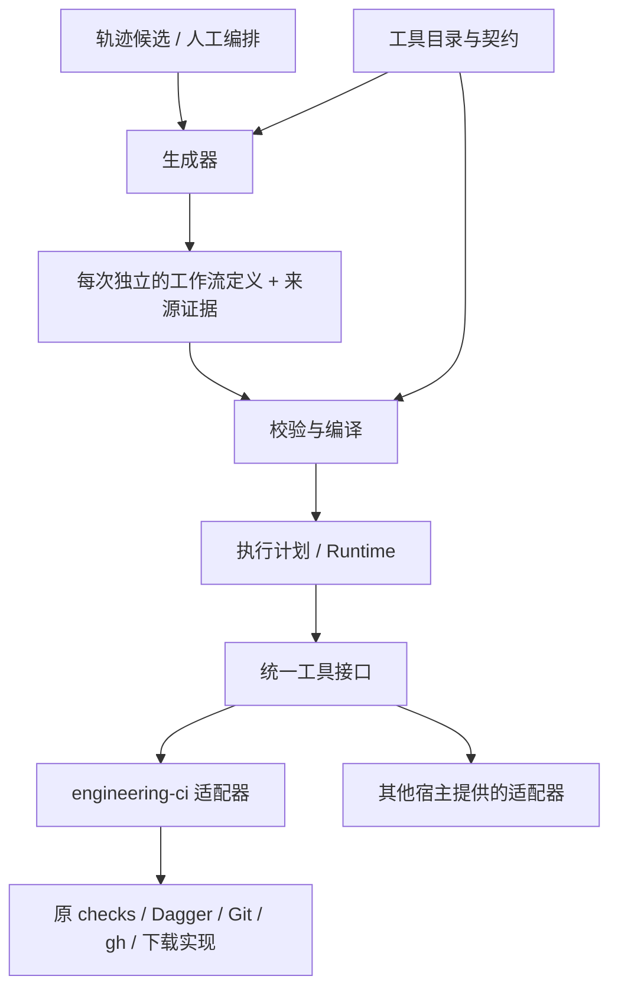

# 独立生成工作流与工具编排

## 状态与目标

本方案记录用户确定的基础架构：配置驱动的工作流以统一工具契约调用外部能力，
每次生成独立产物，生成链路与原项目执行链路分开，核心可剥离、适配器可替换。
本文维护契约及验收边界。v0.6.1 已接入独立生成、校验、执行及恢复入口，实际操作见
[使用指南](../../../guides/generated-workflows.md)。

PR #25 早期的候选证据绑定保留为宿主 CLI 兼容桥，不是新的生成定义。
当前执行读取各步骤的 tool、inputs、needs 和条件，原 checks.py 不反向依赖 mining
或 workflow_core。旧原型证据与新架构验收分开记录。
将每次生成的业务映射放回 config/pipeline.toml 的建议不采用。

目标是把工具变化限制在适配层，把工作流变化表达在独立配置中。
初期仍在 engineering-ci 的原 checkout 和同一个功能 PR 中推进，不提前创建独立仓库。
未来迁出核心时保留公开契约及产物格式；宿主适配层调整导入和组装位置。

## 依赖方向



核心只理解工具契约、步骤图、数据引用、执行上下文及真实结果，不导入本项目的
checks、Pipeline 全局对象、release、tracing 数据库或 mining 后端。
工具目录由宿主显式组装，生成文件只引用工具 ID，不包含 Python 导入路径或任意 shell。
原 checks、下载和发布模块继续可独立调用，不反向导入生成器或通用 Runtime。
轨迹查询及候选核验由来源适配层提供，核心不需要 PostgreSQL 或 Codex 格式。

## 粒度与统一命名

以可独立声明输入输出、判断结果、副作用及恢复方式的操作作为工具粒度。
不按每个内部 subprocess 拆工具，也不把整个 PR→Merge→Release 隐藏成唯一工具。

工具 ID 使用稳定的 `<namespace>.<action>`，namespace/action 使用小写字母、数字与连字符。
契约版本单独记录，不把已安装二进制版本或 Python 路径混入 ID。
步骤 ID 由工作流定义，是一次调用的名字，不是工具名；同一工具可被多个步骤调用。

当前已注册检查和报告查询；后续有实际需求时才注册其他工具：

| 工具 ID | 责任 |
| --- | --- |
| python.ruff-lint / python.ruff-format | 已注册：单项静态检查 |
| python.pytest | 已注册：原 pytest 执行及原结构化结果 |
| engineering-ci.version-check / uv.lock-check | 已注册：版本及锁文件完整性 |
| engineering-ci.check-inspect | 已注册：读取实际报告并核验当前输入 |
| git.commit / git.push | 未注册：未来原生 Git 的单项有副作用操作 |
| github.workflow-dispatch / github.run-get | 未注册：请求与查询分开 |
| github.run-download | 未注册：原日志/Artifact 收集 |

pr-checks 等便利入口保留为组合工作流或明确标注的过渡组合工具。
组合仍应暴露子检查真实结果与身份。拆粒度不意味着重复初始化容器或重复执行 pytest。
当前只有实际接入的工具才实现适配器，Git/OCI/MCP 等例子不要求本轮创建空实现。

## 四类长期契约

| 契约 | 必须表达的内容 | 不承担的责任 |
| --- | --- | --- |
| ToolSpec | tool_id、契约版本、输入/输出 Schema、效果类别、恢复/复用能力、支持的执行环境 | 实际调用、授予权限、存放 token |
| ToolAdapter | 校验/准备输入、解析实际环境与身份、invoke/resume、返回原结果及证据引用 | 改写整个工作流或自行省略其他工具 |
| WorkflowDefinition | 步骤、工具引用、参数、数据/控制依赖、条件和所需能力 | Python 实现、日志全文、实际执行状态 |
| ExecutionContext / ToolResult | 同一执行身份、资源/证据引用、原始结果、完成度及恢复点 | 通过 JSON 生成成功推断原工具成功 |

ToolSpec 描述与 ToolAdapter 的实现由同一注册源提供，不另外维护第二份命令/工具版本注册表。
宿主可提供 Python、CLI、HTTP 或未来 MCP 适配器；核心通过同一接口调用。
输入输出使用 [JSON Schema 2020-12](https://json-schema.org/draft/2020-12)；
[MCP 工具规范](https://modelcontextprotocol.io/specification/2025-11-25/server/tools)
同样提供名称与输入/输出 Schema，但 MCP 只作为可能的接入方式，不成为核心的强制依赖。
工具效果描述用于准入和诊断，真实授权仍由宿主执行策略决定，不因配置或描述声明而扩大权限。

ToolResult 分开保存：原工具执行结果/退出码、必需输出完整度、报告是否生成、
证据是否当前有效、是否复用及其实际来源。失败测试可以生成报告，工具仍然失败。
不能识别 Dagger 缓存来源时保留 unknown，不能凭外层调用完成认定新执行了测试。

跨工具数据使用可序列化的资源引用：文件/目录/报告的类型、摘要及解析句柄，
远端 Run 等资源保留该工具的真实身份与版本。SDK 对象留在执行后端，
不把 Dagger Container 或宿主绝对路径当成可跨项目传递的通用业务数据。
适配器验证资源可访问性与输入语义；Schema 校验不替代内容、身份或权限核验。

## 配置、生成记录与执行记录

三类文件有不同类型标记与 Schema；解析器按 kind/schema_version 区分，不能仅根据目录猜测。
工作流声明的规范表示采用 JSON，便于生成及 Schema 校验；以后其他编写格式由前端转换，
不在每个执行后端重新定义一套流程语言。

宿主可指定输出父目录；当前产物结构如下：

```text
workflow-generated/<generation-id>/
  workflow.json       # kind=generated-workflow，实际工具、步骤和参数
  provenance.json     # 生成器、来源、显式映射及其未知条件
workflow-runs/<execution-id>/
  state.json          # 当前执行恢复点
  result.json         # 完整结果、停点及继续调用
  tool-results/       # 原工具证据、逐项 attempt 意图/回执及受核验的引用
```

每次生成分配独立 generation_id，不覆盖旧生成；相同语义内容可有相同 definition_id。
definition_id 摘要覆盖定义语义与工具契约；generation_id 表示生成动作，execution_id 表示运行，
attempt 表示工具调用尝试，四者不能混用。
定义与 provenance 通过摘要关联；后续修改应生成新产物，不能保留旧摘要冒充原生成。
记录 kind、Schema、生成器版本和实际来源，不用项目版本代替所有契约版本。
每次运行独立输出；恢复使用同一 execution_id，创建新运行使用新 ID。
复用先前工具结果通过显式证据引用及身份核验，不依赖覆盖同一个结果文件。
新结果目录、generation_id 或 execution_id 本身不能被当成代码输入变化而触发重复测试。
复用时引用已经校验的不可变工具结果；需要重新执行时分配本次输出。
实际参数、输入内容和环境仍按工具契约参与身份，不能为了复用擅自删除原执行参数。

定义可以审查后放入任意受支持目录或提交为独立文件；核心不硬编码 engineering-ci 的根路径。
config/pipeline.toml 保留原项目检查定义，只是 engineering-ci 工具适配器的输入之一，
不成为生成工作流的汇总文件。
凭据使用宿主解析的引用，原始 Trace、DSN、token、签名 URL 不进入生成定义或公开结果。
同一执行内各步骤拥有独立输出位置，避免并行工具写同一个 JUnit/JSON 文件。
大日志与文件保留为原生对象/文件引用，不复制进核心结果；上下文提供受允许的资源解析。

## 图语义与数据连接

步骤配置至少具有 id、tool、contract_version、inputs、needs 和执行条件。
数据引用用明确的生产者步骤与 [JSON Pointer](https://www.rfc-editor.org/rfc/rfc6901)
选择输出，和 JSON Schema 的静态 $ref 分开；不执行任意表达式。
数据引用产生依赖边，needs 表达没有数据传递的控制顺序，两者一起做图校验。
校验重复 ID、未知工具、契约不兼容、缺失节点、循环依赖及可确定的输入/输出类型错误。
动态返回值在工具完成时再次校验，不能只凭 Schema 看似兼容就认定具体输出已产生。

首版图原语为 DAG、有限条件、就绪批次及显式诊断分支。
核心逐批调用适配器；就绪节点是否并行执行由后端决定，不把计划的并行能力当作已执行事实。
循环、动态扩图、嵌套子流程应分别声明能力，未实现前明确拒绝；不假装已支持任意程序。
需要重复调用时由恢复契约控制，不能把重试和一般业务循环混成一个功能。
使用 [graphlib](https://docs.python.org/3/library/graphlib.html) 等成熟图能力核对依赖与环，
不重新写拓扑算法。独立节点没有隐含因果顺序。

required 步骤未执行或结果不完整不能记为 passed；条件未满足保留 skipped。
普通业务后继默认要求前置成功；诊断/清理分支显式声明可在失败后执行，
例如远端 Workflow 失败后继续收集日志，最终仍返回失败。
空定义或缺少必需结果不能通过。通用 Runtime 的成功不等于项目 PR/Release 的放行资格；
正式门禁继续使用原规则、实际 SHA、Run/Attempt 与证据。

## Dagger、上下文与恢复

[Dagger](https://docs.dagger.io/getting-started/introduction/) 提供容器及 DAG 执行能力；
其 [缓存](https://docs.dagger.io/reference/configuration/cache) 与工作流证据复用分别记录。
当前同参数的就绪检查共用原 Dagger 准备与 Artifact 请求。不同参数或依赖批次分别调用
原入口，复用原 Engine 缓存；跨批次长驻 SDK 会话尚未实现。后续会话扩展保持适配器边界。
工具数量不决定 Dagger 初始化次数；原 Git/HTTP/GitHub 实现仍调用成熟组件。
Runtime 不重新实现容器传输、分段下载或 GitHub 同一次 Workflow 的 Job 调度。

Pipeline、Runtime 和层次化 FSM 共享同一个执行上下文，步骤使用它的受限视图及子调用身份。
上下文承载 definition/generation/execution、资源、授权需求与可核验的前置结果。
前置证据成为后继实际输入和准入依据；不按相近时间、相同版本或相同仓库拼接证据。
Runtime 和主 FSM 持有同一个 ExecutionContext，适配器调用接收该对象；前置事实提供
结构只读、与权威检查点隔离的视图。检查点保存解析后的 input_sha256 和实际 output_sha256，
可以直接核对数据引用是否传入下一工具，不把计划的引用当作执行证据。
Runtime 持有一个主执行 FSM 和逐项步骤事实，调度读取同一检查点，生成配置只声明流程。
主阶段为 READY/RUNNING/PAUSED/UNKNOWN/FINISHED，子项独立保存 pending/running/实际结果，
不会为工具、Job 和 Artifact 的所有组合制造平面状态。
原 release/execution FSM 留在业务适配器中，通用核心引用其检查点，不复制全部领域状态。

读操作、可重启操作、幂等写入、响应丢失的未知写入具有不同恢复策略。
UNKNOWN 写操作先查询/人工核验，不自动再次 Dispatch、Commit 或 Publish。
已知写入结果不重新分类为 UNKNOWN。缺少领域恢复验证接口时保留原结果，在 PAUSED/blocked
等待人工或领域核验，并保持原失败退出码。本轮宿主没有注册写工具，相关边界由替身测试验收。
中断后输出精确状态、已完成证据、执行 ID/路径和完整下一调用；status 只读、resume 使用已有执行。
输入、工具或环境变化使相关结果失效；运行中输入改变不能产生当前有效通过记录。
必需工具/执行环境缺失明确 unavailable/missing_tool，不静默换后端或用 skipped 代替成功。

## 可剥离的代码边界与调用面

当前代码边界：

```text
src/engineering_ci/
  workflow_core/       # 契约、定义校验/编译、Runtime、上下文与本地检查点
  workflow_adapters/   # engineering-ci 原模块及 Dagger 的实际适配
  cli/workflow.py     # 当前宿主的组装与命令入口
  mining/             # 保持分析；通过来源适配传递候选引用
```

core 内部允许相对导入自身模块，外部系统通过 Protocol/参数注入，
不增加依赖注入框架。当前宿主提供工具目录及输出根；资源和权限在实际适配器中核验。
本地检查点使用核心的有界原子 JSON 与文件锁，不声明尚未实现的数据库 Store 接口。
原执行模块不导入 workflow_core；移除新功能后原命令仍能工作。
把核心目录迁到独立包后，原工程只保留适配器与组装层。

当前调用面包括 tools、schemas、generate、validate、run、status、resume：
tools 返回可调用工具及契约；generate 写独立配置；validate 只核对定义与运行准入；
run 执行定义；status 读已有事实；resume 继续同一执行。
各入口支持 Codex 非交互调用及机器结果，原 CLI 参数保持原责任。
CLI 的 Python console-script 注册不等于工具目录注册，不为每个工具增加 pyproject.toml 入口。
Schema 2020-12 的唯一实现源为 workflow_core/schemas.py，可通过 schemas 导出。
ToolSpec 与具体 Adapter 由同一 Catalog.register 调用绑定；ChecksAdapter 从原 Operation
集合派生描述，不复制命令或工具版本。invoke 接收同一就绪批次及执行上下文，Invocation.previous
携带待核验的旧事实；检查适配器将恢复交给原 checks/Dagger，而非核心猜测复用。
静态 validate 不执行工具预检或承诺当前输入通过，实际环境及资源在调用时核验。

OTel/GenAI 及既有 instrumentation 继续承担适用的遥测。
当前已有原工具结果、步骤/attempt 和输入输出摘要，尚未形成完整的统一操作观测与反馈归档接口。
后续按[Harness 实施设计](harness.md)从实际调用取得工具身份和已核验的复用来源，
不把生成配置的计划步骤或最终检查点当成完整 Trace。
工具实现替换不改写历史轨迹，投影/分析升级继续独立于工作流定义和 Runtime。

## 实施顺序与架构验收

1. 已实现四类契约、Schema、命名和依赖方向；隔离测试核对核心不依赖项目业务。
2. 已实现每次独立生成的定义/来源及只读集中校验，配置决定工具、参数、条件和依赖。
3. 已接 checks 和报告查询适配器，保留原模块独立；实际验收记录见验证目录。
4. 已暴露五个原子检查及事实；pr 在生成时展开完整现有 Profile，同批次共享 Dagger。
5. 有实际需求后再加入 Git/GitHub/其他协议适配或独立仓库，不创建空后端。

必须有直接验收证据：

- 两次生成独立文件，生成定义、来源和结果可明确识别；旧产物不被覆盖。
- 两个不同工具的合法组合改变实际调用顺序及参数，不只是改标签；输入引用确实传递。
- 替换工具适配器不修改核心；核心隔离测试无需 engineering-ci、Dagger 或数据库。
- 丢失工具、环、类型不匹配、输出缺失、未支持能力在恰当阶段拒绝，副作用前完成可确定的校验。
- 真实测试失败、失败报告生成、同输入复用、输入变化和中断恢复保留原语义。
- 任意组合、子流程或重试不能绕过原 Release/权限/UNKNOWN 约束。
- 正向/负向实际执行与替身测试分别记录；旧绑定结果只作为历史证据，不冒充新架构验收。

Schema 主版本、工具契约版本和必需能力是兼容边界。
定义引用具体工具契约及其内容摘要，实现版本与二进制版本另入运行身份。
两个适配器可以实现同一契约；旧契约不再提供时，显式拒绝并给出迁移方式，
不能仅凭相同名字或主版本推断兼容。
新增工具或适配器通过目录扩展；未知必需能力拒绝、破坏性变化提供显式迁移，
不以不断增加业务 if/else 或修改所有已生成工作流解决版本变化。
