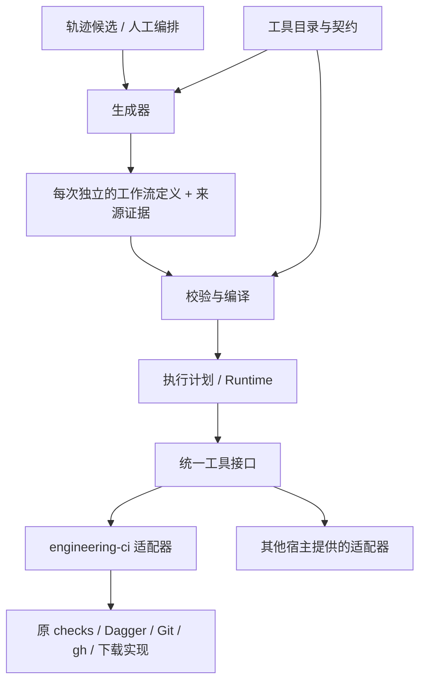

# 独立生成工作流与工具编排

## 状态与目标

本方案记录用户确定的基础架构：配置驱动的工作流以统一工具契约调用外部能力，
每次生成独立产物，生成链路与原项目执行链路分开，核心可剥离、适配器可替换。
本文维护契约及验收边界。v0.6.1 已接入独立生成、校验、执行及恢复入口，实际操作见
[使用指南](../../../guides/generated-workflows.md)。

PR #25 早期的候选证据绑定保留为宿主 CLI 兼容桥，不是新的生成定义。
当前执行读取各步骤的 tool、inputs、needs 和条件，原 checks.py 不反向依赖 mining
或 workflow_core。旧原型证据与新架构验收分开记录。
将每次生成的业务映射放回 config/pipeline.toml 的建议不采用。

目标是把工具变化限制在适配层，把工作流变化表达在独立配置中。
早期实现在 engineering-ci 中完成。v0.6.6 将通用 Runtime、工具契约、归档与分析迁入
Vesryn v0.1.0；engineering-ci 保留 CI 领域准入与兼容入口。
公开产物格式、Tool ID 及历史证据身份保持不变。职责和固定依赖见
[分仓契约](repository-split.md)。本轮不实现自动 Loop 或策略学习。

## 依赖方向



核心只理解工具契约、步骤图、数据引用、执行上下文及真实结果，不导入本项目的
checks、Pipeline 全局对象、release、tracing 数据库或 mining 后端。
工具目录由宿主显式组装，生成文件只引用工具 ID，不包含 Python 导入路径或任意 shell。
原 checks、下载和发布模块继续可独立调用，不反向导入生成器或通用 Runtime。
轨迹查询及候选核验由来源适配层提供，核心不需要 PostgreSQL 或 Codex 格式。

## 粒度与统一命名

以可独立声明输入输出、判断结果、副作用及恢复方式的操作作为工具粒度。
不按每个内部 subprocess 拆工具，也不把整个 PR→Merge→Release 隐藏成唯一工具。

工具 ID 使用稳定的 `<namespace>.<action>`，namespace/action 使用小写字母、数字与连字符。
契约版本单独记录，不把已安装二进制版本或 Python 路径混入 ID。
步骤 ID 由工作流定义，是一次调用的名字，不是工具名；同一工具可被多个步骤调用。

当前已注册检查和报告查询；后续有实际需求时才注册其他工具：

| 工具 ID | 责任 |
| --- | --- |
| python.ruff-lint / python.ruff-format | 已注册：单项静态检查 |
| python.pytest | 已注册：原 pytest 执行及原结构化结果 |
| engineering-ci.version-check / uv.lock-check | 已注册：版本及锁文件完整性 |
| engineering-ci.check-inspect | 已注册：读取实际报告并核验当前输入 |
| git.commit / git.push | 未注册：未来原生 Git 的单项有副作用操作 |
| github.workflow-dispatch / github.run-get | 未注册：请求与查询分开 |
| github.run-download | 未注册：原日志/Artifact 收集 |

pr-checks 等便利入口保留为组合工作流或明确标注的过渡组合工具。
组合仍应暴露子检查真实结果与身份。拆粒度不意味着重复初始化容器或重复执行 pytest。
当前只有实际接入的工具才实现适配器，Git/OCI/MCP 等例子不要求本轮创建空实现。

## 四类长期契约

| 契约 | 必须表达的内容 | 不承担的责任 |
| --- | --- | --- |
| ToolSpec | tool_id、契约版本、输入/输出 Schema、效果类别、恢复/复用能力、支持的执行环境 | 实际调用、授予权限、存放 token |
| ToolAdapter | 校验/准备输入、解析实际环境与身份、invoke/resume、返回原结果及证据引用 | 改写整个工作流或自行省略其他工具 |
| WorkflowDefinition | 步骤、工具引用、参数、数据/控制依赖、条件和所需能力 | Python 实现、日志全文、实际执行状态 |
| ExecutionContext / ToolResult | 同一执行身份、资源/证据引用、原始结果、完成度及恢复点 | 通过 JSON 生成成功推断原工具成功 |

ToolSpec 描述与 ToolAdapter 的实现由同一注册源提供，不另外维护第二份命令/工具版本注册表。
宿主可提供 Python、CLI、HTTP 或未来 MCP 适配器；核心通过同一接口调用。
输入输出使用 [JSON Schema 2020-12](https://json-schema.org/draft/2020-12)；
[MCP 工具规范](https://modelcontextprotocol.io/specification/2025-11-25/server/tools)
同样提供名称与输入/输出 Schema，但 MCP 只作为可能的接入方式，不成为核心的强制依赖。
工具效果描述用于准入和诊断，真实授权仍由宿主执行策略决定，不因配置或描述声明而扩大权限。

ToolResult 分开保存：原工具执行结果/退出码、必需输出完整度、报告是否生成、
证据是否当前有效、是否复用及其实际来源。失败测试可以生成报告，工具仍然失败。
不能识别 Dagger 缓存来源时保留 unknown，不能凭外层调用完成认定新执行了测试。

跨工具数据使用可序列化的资源引用：文件/目录/报告的类型、摘要及解析句柄，
远端 Run 等资源保留该工具的真实身份与版本。SDK 对象留在执行后端，
不把 Dagger Container 或宿主绝对路径当成可跨项目传递的通用业务数据。
适配器验证资源可访问性与输入语义；Schema 校验不替代内容、身份或权限核验。

## 配置、生成记录与执行记录

三类文件有不同类型标记与 Schema；解析器按 kind/schema_version 区分，不能仅根据目录猜测。
工作流声明的规范表示采用 JSON，便于生成及 Schema 校验；以后其他编写格式由前端转换，
不在每个执行后端重新定义一套流程语言。

宿主可指定输出父目录；当前产物结构如下：

```text
workflow-generated/<generation-id>/
  workflow.json       # kind=generated-workflow，实际工具、步骤和参数
  provenance.json     # 生成器、来源、显式映射及其未知条件
workflow-runs/<execution-id>/
  state.json          # 当前执行恢复点
  result.json         # 完整结果、停点及继续调用
  observations/       # 按调用会话顺序保存的不可覆盖操作观测
  reuse-source.json   # 使用 reuse-from 时冻结的原执行检查点
  tool-results/       # 原工具证据、逐项 attempt 意图/回执及受核验的引用
```

每次生成分配独立 generation_id，不覆盖旧生成；相同语义内容可有相同 definition_id。
definition_id 摘要覆盖定义语义与工具契约；generation_id 表示生成动作，execution_id 表示运行，
attempt 表示工具调用尝试，四者不能混用。
定义与 provenance 通过摘要关联；后续修改应生成新产物，不能保留旧摘要冒充原生成。
记录 kind、Schema、生成器版本和实际来源，不用项目版本代替所有契约版本。
每次运行独立输出；恢复使用同一 execution_id，创建新运行使用新 ID。
复用先前工具结果通过显式证据引用及身份核验，不依赖覆盖同一个结果文件。
新结果目录、generation_id 或 execution_id 本身不能被当成代码输入变化而触发重复测试。
复用时引用已经校验的不可变工具结果；需要重新执行时分配本次输出。
实际参数、输入内容和环境仍按工具契约参与身份，不能为了复用擅自删除原执行参数。

来源明确选择完整 PR 目标时，provenance.target 记录 registered-profile、Profile 名称、
原 Pipeline 策略摘要及实际 step/tool 映射。来源身份不表示历史工具身份已知。
宿主在 validate/run/resume 核验该策略；配置变化明确拒绝并要求重新生成、审查。
缺少 target 的旧定义仍可读取、执行，但不能冒充已经绑定当前目标策略。
新实现继续读取旧 Schema 1 定义/检查点；旧读取器不认识新增字段时应拒绝，
升级读取器后再使用新产物，不能忽略 target 准入或冒充双向兼容。

定义可以审查后放入任意受支持目录或提交为独立文件；核心不硬编码 engineering-ci 的根路径。
config/pipeline.toml 保留原项目检查定义，只是 engineering-ci 工具适配器的输入之一，
不成为生成工作流的汇总文件。
凭据使用宿主解析的引用，原始 Trace、DSN、token、签名 URL 不进入生成定义或公开结果。
同一执行内各步骤拥有独立输出位置，避免并行工具写同一个 JUnit/JSON 文件。
大日志与文件保留为原生对象/文件引用，不复制进核心结果；上下文提供受允许的资源解析。

## 图语义与数据连接

步骤配置至少具有 id、tool、contract_version、inputs、needs 和执行条件。
数据引用用明确的生产者步骤与 [JSON Pointer](https://www.rfc-editor.org/rfc/rfc6901)
选择输出，和 JSON Schema 的静态 $ref 分开；不执行任意表达式。
数据引用产生依赖边，needs 表达没有数据传递的控制顺序，两者一起做图校验。
校验重复 ID、未知工具、契约不兼容、缺失节点、循环依赖及可确定的输入/输出类型错误。
动态返回值在工具完成时再次校验，不能只凭 Schema 看似兼容就认定具体输出已产生。

首版图原语为 DAG、有限条件、就绪批次及显式诊断分支。
核心逐批调用适配器；就绪节点是否并行执行由后端决定，不把计划的并行能力当作已执行事实。
循环、动态扩图、嵌套子流程应分别声明能力，未实现前明确拒绝；不假装已支持任意程序。
需要重复调用时由恢复契约控制，不能把重试和一般业务循环混成一个功能。
使用 [graphlib](https://docs.python.org/3/library/graphlib.html) 等成熟图能力核对依赖与环，
不重新写拓扑算法。独立节点没有隐含因果顺序。

required 步骤未执行或结果不完整不能记为 passed；条件未满足保留 skipped。
普通业务后继默认要求前置成功；诊断/清理分支显式声明可在失败后执行，
例如远端 Workflow 失败后继续收集日志，最终仍返回失败。
空定义或缺少必需结果不能通过。通用 Runtime 的成功不等于项目 PR/Release 的放行资格；
正式门禁继续使用原规则、实际 SHA、Run/Attempt 与证据。

## Dagger、上下文与恢复

[Dagger](https://docs.dagger.io/getting-started/introduction/) 提供容器及 DAG 执行能力；
其 [缓存](https://docs.dagger.io/reference/configuration/cache) 与工作流证据复用分别记录。
当前同参数的就绪检查共用原 Dagger 准备与 Artifact 请求。不同参数或依赖批次分别调用
原入口，复用原 Engine 缓存；跨批次长驻 SDK 会话尚未实现。后续会话扩展保持适配器边界。
工具数量不决定 Dagger 初始化次数；原 Git/HTTP/GitHub 实现仍调用成熟组件。
Runtime 不重新实现容器传输、分段下载或 GitHub 同一次 Workflow 的 Job 调度。

Pipeline、Runtime 和层次化 FSM 共享同一个执行上下文，步骤使用它的受限视图及子调用身份。
上下文承载 definition/generation/execution、资源、授权需求与可核验的前置结果。
前置证据成为后继实际输入和准入依据；不按相近时间、相同版本或相同仓库拼接证据。
Runtime 和主 FSM 持有同一个 ExecutionContext，适配器调用接收该对象；前置事实提供
结构只读、与权威检查点隔离的视图。检查点保存解析后的 input_sha256 和实际 output_sha256，
可以直接核对数据引用是否传入下一工具，不把计划的引用当作执行证据。
Runtime 持有一个主执行 FSM 和逐项步骤事实，调度读取同一检查点，生成配置只声明流程。
主阶段为 READY/RUNNING/PAUSED/UNKNOWN/FINISHED，子项独立保存 pending/running/实际结果，
不会为工具、Job 和 Artifact 的所有组合制造平面状态。
原 release/execution FSM 留在业务适配器中，通用核心引用其检查点，不复制全部领域状态。

读操作、可重启操作、幂等写入、响应丢失的未知写入具有不同恢复策略。
UNKNOWN 写操作先查询/人工核验，不自动再次 Dispatch、Commit 或 Publish。
已知写入结果不重新分类为 UNKNOWN。缺少领域恢复验证接口时保留原结果，在 PAUSED/blocked
等待人工或领域核验，并保持原失败退出码。本轮宿主没有注册写工具，相关边界由替身测试验收。
中断后输出精确状态、已完成证据、执行 ID/路径和完整下一调用；status 只读、resume 使用已有执行。
输入、工具或环境变化使相关结果失效；运行中输入改变不能产生当前有效通过记录。
必需工具/执行环境缺失明确 unavailable/missing_tool，不静默换后端或用 skipped 代替成功。

## 可剥离的代码边界与调用面

当前代码边界：

```text
vesryn/src/vesryn/
  workflow_core/       # 契约、定义校验/编译、Runtime、上下文与本地检查点
  tracing/            # 通用归档、投影和有界检索
  mining/             # 离线分析与观察候选
engineering-ci/src/engineering_ci/
  workflow_core/       # 旧导入兼容；CI 批准/反馈契约来自宿主适配层
  workflow_adapters/   # engineering-ci 原模块及 Dagger 的实际适配
  cli/workflow.py     # 当前宿主的组装与命令入口
  mining/bindings.py   # CI 候选与完整 PR 检查的显式绑定
```

core 内部允许相对导入自身模块，外部系统通过 Protocol/参数注入，
不增加依赖注入框架。当前宿主提供工具目录及输出根；资源和权限在实际适配器中核验。
本地检查点使用核心的有界原子 JSON 与文件锁，不声明尚未实现的数据库 Store 接口。
原执行模块不导入 workflow_core；移除新功能后原命令仍能工作。
把核心目录迁到独立包后，原工程只保留适配器与组装层。

当前调用面包括 tools、schemas、generate、validate、run、status、resume、evidence、compare：
tools 返回可调用工具及契约；generate 写独立配置；validate 只核对定义与运行准入；
run 执行定义；status 读已有事实；resume 继续同一执行。
evidence 查询指定执行；compare 读取两份原执行证据，既不执行检查，也不选择批准版本。
各入口支持 Codex 非交互调用及机器结果，原 CLI 参数保持原责任。
CLI 的 Python console-script 注册不等于工具目录注册，不为每个工具增加 pyproject.toml 入口。
通用 Schema 2020-12 的唯一实现源为 Vesryn `workflow_core/schemas.py`，
宿主 CI 批准和反馈 Schema 位于 `workflow_adapters/contracts.py`；旧 CLI 聚合导出实际使用的契约。
ToolSpec 与具体 Adapter 由同一 Catalog.register 调用绑定；ChecksAdapter 从原 Operation
集合派生描述，不复制命令或工具版本。invoke 接收同一就绪批次及执行上下文，Invocation.previous
携带待核验的旧事实；检查适配器将恢复交给原 checks/Dagger，而非核心猜测复用。
静态 validate 不执行工具预检或承诺当前输入通过，实际环境及资源在调用时核验。

本地操作观测由同一 Runtime/ExecutionContext 在持久化准入后、调用前及结果落盘后记录。
admitted 是意图，invoking 是实际进入适配器边界，returned 是接收到的原结果；
invoking 的持久化起点不证明子进程已执行；缺少该观测时不能判断调用未发生。
各 attempt 保留，不因 resume 覆盖。recovered 只描述恢复时看见的旧事实，不补造旧调用时间。
invoking/returned 可选记录同一 batch_id、batch_size，表示一次 Runtime 向 Adapter 提交的调用组，
不是后端内部任务数量或并发证明。返回必须对应同一批次；旧记录不含批次时保持未知。
主会话有独立起止与序号；记录仅含身份、摘要、结果布尔事实和本地观测时间，
不复制参数、输出正文或错误字符串。观测写入失败单独计数，不改变原工具退出码。
通用观测 Schema 的唯一实现为 Vesryn `workflow_core/schemas.py`，可通过 workflow schemas 导出。

complete/incomplete/unknown 只表达本地观测协议的覆盖程度，不表示整个 Agent 会话完整或任务成功。
会话缺记录、缺结束、预期 attempt 缺准入记录均为 incomplete；旧检查点缺少协议声明时为 unknown。
读取一个执行的观测最多 10000 记录或 16 MiB，超出范围明确拒绝；输出分页预算不代表任意历史读取成本。

workflow evidence 显式关联本执行的来源、生成身份、逐次调用和原工具回执/资源摘要；
查询与原执行使用同一文件锁，运行中可用 status 查看检查点；不拼接变化中的回执。
原 check.executed 是历史执行事实，actual_check_executed 来自原 executed_this_invocation，
不凭外层 invoke 推测执行了 pytest。复用来源与实际输入/工具/参数/环境摘要分别核对；
同一次执行的前序 attempt 与 reuse-from 的冻结检查点均保留明确引用。
查询只读，current_input_validity=not_checked；原通过记录不因此获得当前代码的放行资格。
原资源损坏时报告 unavailable，保留当时的原结果。未批准与未证明收益始终分别为 false。

check.details 从经摘要核验的原报告读取：允许公开的 coverage/JUnit 相对路径、实际工具版本、
平台/架构/后端和测试统计。不执行版本探测或工具，也不导出命令、绝对安装路径、环境变量或日志。
未提供的事实保持 null/缺失；配置声明的版本不能替代实际版本。身份仍由原检查模块判定，
查询书签同时绑定原回执事实摘要，资源变化使旧书签失效。

### 已观测操作的 Event Log 与分析

mine workflow 读取同一锁保护的完整有界证据视图，交给既有 Rust4PM discovery；
mine export-xes --execution 仅导出同一准入逻辑产生的标准 XES，不要求 SDK、引擎或数据库。
Case 为 execution_id + step_id，只包含该 Step 的连续 attempt；活动名称为实际注册 tool_id。
跨 Step 依赖保留原 DAG，独立 Step 不因时间排序产生直接后继关系。该投影用于观察尝试、失败和
复用，不能发现尚未采集的跨工具 Agent 决策序列。

缺起止、时钟无效、同 Step 时间逆序、原检查证据损坏或没有调用观测的 Case 明确列入排除项。
完整性 incomplete 默认拒绝，显式 --allow-incomplete 后仍保留排除与完整性状态。
unknown 可以分析，但不变成 complete。完整性只覆盖观测协议，与 Case 准入及原任务成功分别表达。
XES 保留事件身份、工具契约、批次、输入/结果/身份分量摘要、原报告摘要、已核验的安全事实及
实际时间。缺失的历史参数或批次不倒填；适配器边界耗时不作为单项检查耗时。

workflow-analysis 是独立的本地分析产物，身份包含 Event Log 内容、分析版本和实际引擎版本。
它不冒充 Codex 投影或 PostgreSQL 现有 analysis 类型，不作为当前 mine candidates/bind 的输入。
分析 passed 只表示数据处理成功，recorded_result 保留原执行结论；current_input_validity=not_checked。
原 Codex 文件/登记分析、比较与候选入口保持原契约。

分析和 XES 独立原子写入且不覆盖旧文件。若分析已保存而 XES 写入失败，命令非零，保留
analysis_saved、analysis_status 和绑定 event_log_id 的导出恢复命令。执行或原资源改变后，
该恢复命令拒绝混用新证据。原工具、质量门禁与 Release 状态均不由导出结果修改。

可选 OTel SDK 投影使用实际 invoking/returned 时间和派生 Span ID，表示适配器调用边界，
同批次 Span 可重叠，不代表每个检查内部耗时或 Agent 决策轮数。
缺结束或时钟逆序不补造 Span；Token/费用与 Dagger 缓存命中保持未知。
普通工程操作使用工程属性，不伪装为 GenAI 模型请求。
当前只导出 SDK Span JSON，不自动传输、归档 PostgreSQL 或调用 Mining。
后续反馈接入仍按[Harness 实施设计](harness.md)进行，不把计划或最终检查点当成完整 Trace。
工具实现替换不改写历史轨迹，投影/分析升级继续独立于工作流定义和 Runtime。

### 完整 PR 检查的受控复用比较

workflow compare 是只读的执行证据比较，不调用 Runtime.resume、Dagger、Mining 或数据库。
输入为两个明确执行目录，同时按稳定顺序持有原执行锁，核验完整观测、回执和资源。
门禁字段来自同一次原报告读取，只用于比较视图，不改变原查询证据身份。

首个目标限定为完整已注册 PR Profile：原必需 Step 不能省略、改为 optional 或更换成功条件。
两侧语义定义、候选来源、逐项工具契约、解析输入以及原检查的完整执行身份必须一致；
输入、参数、工具、环境和 Executor 摘要分别列出差异。固定挖掘结果等价不替代这些检查。
目标策略过期、执行未结束、观测不完整、丢失回执、缺身份或多次 attempt 均保存 not_comparable。
历史和匹配的单项结果仍保留，不删除已验证证据或把一次不匹配扩大为所有数据无效。

基线必须有一次未复用的原检查提交；候选使用既有 run --reuse-from 准入。
候选复用必须指向这份基线的冻结检查点、确切 step/attempt/result 摘要及同一资源，
其他执行的通过记录不能冒充本次控制样本。同一执行不能同时当作独立基线和候选。
重复 resume 的全历史保留并显示计数，当前不自动选择有利的一次 attempt；需要独立样本时
由调用者使用已有 run 新建执行，UNKNOWN 写操作仍遵守原恢复规则。

统计区分原 required_checks、observed_check_attempts、原报告标记的 check_submissions、
reused_checks 和 Runtime adapter_batches。提交数依据 executed_this_invocation，
不是操作系统进程数或 Dagger 缓存未命中数。两侧不禁用或清空原缓存，不改变既有执行策略；
cache_policy=backend-managed，命中状态未观测。因此不作速度、CPU、费用或整体 Agent 效果归因。

原报告、原 ToolResult 和最终执行必须都是完整通过，才满足 recorded_quality_gate=passed。
不同测试统计拒绝等价；失败、未执行、缺必需结果或输入执行时变化都不能由比较报告放行。
可比且质量通过、提交确实减少时，optimization_verified=true 仅限定为
verified_scope=check-submission-reuse。无减少仍可比较，但不宣称收益；失败复用保留原非零结果。

workflow-comparison 为独立本地报告；ID 绑定两份精确证据与比较版本、目标和范围。
缺乏可比性或质量不满足时仍保存报告，命令退出 3；已比较且原质量通过时退出 0，
退出 0 不意味着 optimization_verified 一定为 true。--out 必须新文件；--json 是另存的操作回执，
不能覆盖报告或原执行目录。保存失败单独非零并返回源执行和查询动作，不改原 FSM/门禁。
报告始终 current_input_validity=not_checked、approved=false，不作为当前代码或 Release 准入，
也不修改生成定义内的优化/批准状态。本轮不建立试验调度或批准存储。

## 能力批准、版本选择与执行反馈

v0.6.4 的 P2 在现有 CLI/Core/Adapter 上接入首个完整 PR 检查能力。P1 比较文件保持
只读、approved=false；独立批准文件关联它，不改写原结论。操作步骤见
[生成工作流指南](../../../guides/generated-workflows.md#批准启用选择与调用能力)。

### 准入与存储

`workflow approve COMPARISON BASELINE_DIR CANDIDATE_DIR --name NAME --version VERSION`
是显式批准动作，不执行检查、不启用能力。Adapter 锁定原执行，重新计算完整比较并要求
文件一致、原门禁 passed、optimization_verified=true，且定义具有显式候选来源。
historical_check_identity=unavailable 仍保留，不倒填原 Codex Trace 的操作身份。

能力版本如 1.0.0，与项目发行版本 0.6.4 独立。批准绑定精确 definition/generation、原
工具契约、Workflow/Provenance 摘要、比较规则及结果摘要、两侧完整证据快照。Schema
由 `workflow schemas` 导出 capability_approval、capability_catalog、capability_call、
capability_feedback，复用原 JSON Schema 校验。每个版本独立保存 workflow/provenance/
comparison/approval 文件，不汇总进 pipeline.toml，不增加 console-script 或 Tool Catalog。

默认 store 是主 checkout 的 `.test-tools/workflow-capabilities`，可显式 `--store`。它是
机器本地批准记录，Git 忽略，不是签名、账户认证或 GitHub 发布门禁。操作者须保留 store
及原证据；换输入后不能仅凭同版本号声称准入成功。本地批准表示执行了显式命令，
不认证“是谁审查”，Agent 调用仍服从宿主授权。

单一 catalog.json 记录批准索引和 active 指针；文件锁串行化更新与调用准入，原子替换
避免半写入。部分版本文件写入失败不会进入索引，同命令可补齐相同文件后恢复；同一
name/version 对应不同批准则失败，不覆盖历史。索引最多 256 个版本，达到上限明确拒绝。

### 选择与执行

批准与启用分开。activate 再核验定义、当前 Catalog/目标策略及原比较证据，才切换 active
指针。select 只查明确启用版本，没有自动最新规则。capabilities 从显式索引返回有界摘要、
过滤及游标，标明 admission/current input 尚未核验；不扫描目录猜测已批准状态。
选择变化使分页游标失效。换回旧版本须显式 activate，仍接受同样准入。

call 在 catalog 锁下选择并冻结批准版本，通过原 Runtime 创建新执行并保存 capability.json，
再交给原 FSM/Adapter。默认引用已批准候选执行的冻结结果；五个原工具分别核对当前源码、
工具/参数/环境及资源，变化项重跑，原失败保持非零。历史试验不能替代当前代码检查。
原试验入口 workflow run 保持独立，不依赖 P2 批准。

deactivate 只阻止后续选择，不取消已准入执行或删除回执。status/resume 继续使用原检查点、
同一 ExecutionContext 与冻结绑定；之后切换/停用能力也不替换恢复中的版本。停用不等于
撤销外部副作用；当前 Catalog 仍无 Git Commit、Dispatch、Merge 或 Release 写工具。

### 实际执行反馈与 PostgreSQL

call/resume 完成后从原记录提取安全反馈。写入失败单独为 unavailable，原工具退出码不变。
`workflow feedback EXECUTION_DIR` 可补写：同一状态/观测/资源及能力绑定产生同一
feedback_id，新的 attempt/结果生成新记录。不认证任务总体成功、当前输入仍有效或新的
优化收益，不复制日志、Prompt、参数原值、环境变量或 Token。

`feedback --archive` 才写入已有 VESRYN_DATABASE。migration 003 在组件专用 schema 新增
workflow_feedback；反馈不是 Codex 原始事件、projection 或 analysis，不冒用它们的身份。
SQL 事务按 feedback_id 幂等插入并读回校验摘要；冲突、权限不足或网络失败均非 registered，
保留本地反馈和原执行。重复归档不重复检查、不自动迁移。

schema 1/2 保持已有读取/回放语义；反馈要求显式 trace init 升级到 3，保留旧原字节和派生
记录。tracing.toml 格式仍是 schema_version=1。自动调优、跨版本试验调度、任意任务批准、
签名身份认证和远端能力分发尚未实现；原 PR/Release 人工授权与门禁保持独立。

P3-1 的 `workflow feedback-query` 单独只读已归档安全事实，不依赖本地批准目录/执行
文件，不改变上述保存/归档或执行动作；分页、过滤与预算由
[反馈检索契约](retrieval.md#已归档能力反馈的只读检索p3-1)定义。

### 反馈文档 v2 与 Attempt 索引

P3-2 的新反馈文档 schema_version=2；它与数据库 schema 3、tracing.toml 版本及项目版本
独立。原 schema_version=1 文档继续校验、查询和归档；不重写历史或用累计数补造索引。
同一执行重新提取 v2 会生成新的内容身份，原 v1 文件/归档仍保留，不重复执行检查。

v2 必须携带 attempt_snapshot，协议为 workflow-feedback-attempts/1。它从已有稳定执行
视图提取 required_step_ids 及安全 Attempt 索引：step_id/attempt、工具/契约、session/batch
身份、原输入/结果与源证据行摘要、观测边界、原检查证据可用性、提交/复用标记及退出结果。
不携带路径、命令、参数原值、日志、Prompt、环境变量或凭据。来源行摘要是已记录引用，
不是签名或远端身份认证；只读汇总不重新打开原执行文件。

核心校验拒绝重复 Step/Attempt、未声明的 Step、complete 索引的编号缺口、缺边界、
不可用检查伪造测量值及累计 metrics 与索引不一致。原工具退出码不因索引保存失败而改变。
观测 incomplete/unknown、测量未知和原失败保持可见；不知道的值不能补成零。
内容受原 2 MiB 文档限制，超限返回反馈保存失败，不截断索引后冒充完整。

索引仅证明所记录的 Attempt 身份及事实。覆盖与汇总见
[P3-2 检索契约](retrieval.md#已归档反馈的覆盖与汇总p3-2)，不以计数增长或归档时间推断
执行先后、原成功或现有能力可用性。旧客户端只支持 v1 时不能读取 v2；数据库不需迁移。

## 实施顺序与架构验收

1. 已实现四类契约、Schema、命名和依赖方向；隔离测试核对核心不依赖项目业务。
2. 已实现每次独立生成的定义/来源及只读集中校验，配置决定工具、参数、条件和依赖。
3. 已接 checks 和报告查询适配器，保留原模块独立；实际验收记录见验证目录。
4. 已暴露五个原子检查及事实；pr 在生成时展开完整现有 Profile，同批次共享 Dagger。
5. 有实际需求后再加入 Git/GitHub/其他协议适配或独立仓库，不创建空后端。

必须有直接验收证据：

- 两次生成独立文件，生成定义、来源和结果可明确识别；旧产物不被覆盖。
- 两个不同工具的合法组合改变实际调用顺序及参数，不只是改标签；输入引用确实传递。
- 替换工具适配器不修改核心；核心隔离测试无需 engineering-ci、Dagger 或数据库。
- 丢失工具、环、类型不匹配、输出缺失、未支持能力在恰当阶段拒绝，副作用前完成可确定的校验。
- 真实测试失败、失败报告生成、同输入复用、输入变化和中断恢复保留原语义。
- 任意组合、子流程或重试不能绕过原 Release/权限/UNKNOWN 约束。
- 正向/负向实际执行与替身测试分别记录；旧绑定结果只作为历史证据，不冒充新架构验收。

Schema 主版本、工具契约版本和必需能力是兼容边界。
定义引用具体工具契约及其内容摘要，实现版本与二进制版本另入运行身份。
两个适配器可以实现同一契约；旧契约不再提供时，显式拒绝并给出迁移方式，
不能仅凭相同名字或主版本推断兼容。
新增工具或适配器通过目录扩展；未知必需能力拒绝、破坏性变化提供显式迁移，
不以不断增加业务 if/else 或修改所有已生成工作流解决版本变化。
