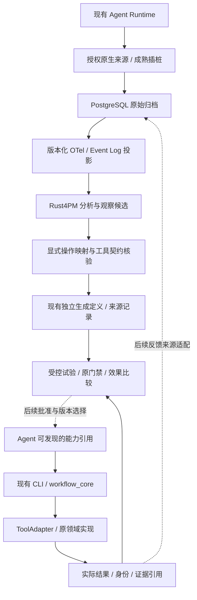

# Agent Harness Optimization — 实施设计

## 定位与范围

当前扩展方向是 Agent Harness Optimization：以真实执行证据发现可复用模式，
通过显式工具契约、试验和验证，将候选转为 Agent 可调用的能力，再观察使用效果。
engineering-ci 是当前宿主和首个验收目标，Codex 是当前使用的 Agent。
优化层不重建 Agent 的模型调用循环或会话管理，也不接管原项目的 CI/Release 门禁。

本文件维护后续实施顺序和闭环准入。已完成的归档/分析设计保留在
[实施方案](design.md)，工作流格式和 Runtime 以[生成与执行契约](generated-workflows.md)为准，
查询以[分层检索](retrieval.md)为准；不另建一套 IR、工具注册表或查询 Schema。

当前具备闭环的基础部件，尚未证明完整优化闭环。生成定义、执行通过、同输入复用，
分别是有效能力，但都不能单独证明 Agent 的决策、费用或任务失败率下降。

## 当前实现与缺口

| 能力 | 当前事实 | 仍需补齐 |
| --- | --- | --- |
| 来源与归档 | 显式选择的 Codex rollout、原字节/CloudEvents、固定快照、幂等恢复、PostgreSQL | 不声称覆盖所有 Agent/API；来源未证明无缺失时保留 unknown |
| 标准投影 | 官方 OTel SDK、原时间与结果、三类原生 item 活动 | 活动名称不是精确 Tool ID；没有完整模型调用、参数或费用投影 |
| 流程分析 | Rust4PM 变体/DFG、case 准入、相邻重复/重复变体/观察后继候选 | 任意公共子流程、因果依赖、自动参数抽象未实现 |
| 工具契约 | 一个 Catalog 绑定 ToolSpec 与 Adapter；五个原检查及报告核验已注册 | 没有自动语义匹配、远端工具安装或真实写工具适配 |
| 独立生成与执行 | 独立 workflow/provenance、受限 DAG、数据引用、共享上下文、FSM 和恢复 | 历史候选到目标是显式选择，不是从粗粒度活动自动提取原检查 |
| 证据与复用 | 原工具结果、逐 attempt 观测、输入/输出摘要、原报告/复用来源及 OTel SDK 投影 | 只覆盖当前 Runtime 调用；完整 Agent 操作流、成本与 PostgreSQL 反馈尚未接入 |
| 查询 | Summary/Pattern/Candidate/Evidence/授权 Raw，过滤/分页/输出预算 | 候选与批准/激活记录尚未关联；不扫描文件夹猜测已验证状态 |
| Agent 使用 | 当前 Codex 能通过现有 CLI 生成、执行、查询和恢复 | 已批准能力的发现、版本选择和效果反馈闭环尚未完成 |

当前 `mine compare` 比较固定输入的分析结果；不是原工作流与候选工作流的 A/B 评估。
已有实测和未覆盖范围分别见[轨迹验收](../../verification/trace-validation.md)与
[工作流验收](../../verification/workflow-validation.md)，不重复执行这些已完成阶段作为新功能。

## 职责与数据流

这是职责图，不表示所有节点均已完成。当前没有 LLM Adapter、MCP Server 或 Skill 发布器。
优化侧读取观察并准备候选；生产执行继续通过已批准的定义与现有工具进行。
优化分析或反馈归档不可用时，不得改写已经获得的工具结果或影响原任务失败判定。

边界复用当前模块，不按图中的每个名称创建目录、服务或空实现：

| 边界 | 负责 | 不负责 |
| --- | --- | --- |
| tracing / mining | 归档、投影、分析、观察候选与有界查询 | 执行历史调用、推断授权、自动改检查策略 |
| 来源与候选组装层 | 核验来源、显式参数/目标映射、传递引用 | 把 DFG 当执行计划或隐藏未知项 |
| workflow_core | 定义校验、受限 DAG 协调、共享上下文、结果及恢复 | 实现工具业务、容器引擎、远端 Job 调度 |
| workflow_adapters / 宿主 | 原工具调用、资源身份、环境、权限及业务准入 | 通过声明元数据授予权限或弱化原质量门禁 |
| 后续验证/反馈层 | 关联原结果、候选、试验与版本选择，比较实际观测 | 自建 Agent Runtime、模型会话管理或任意任务调度平台 |

当前 core 已有独立导入验收；整个归档/分析子系统尚不是独立发行包。
“可剥离”约束依赖方向，不意味着接受任意 Pipeline 格式。
工作流有明确的版本化格式，其他宿主或格式需要实际适配和验证。

## 必须修正的设计判断

### 受限调用层与领域执行

保留已经实现的 Runtime/FSM/工具接口。不新增第二个通用执行引擎，
也不为避免“执行引擎”这个词删除已有编排层。
本地步骤的协调由 core 完成，容器执行交给 Dagger，远端 Job DAG 交给 GitHub Actions，
工具业务和副作用恢复交给原领域实现。Pipeline 与 FSM 持有同一个 ExecutionContext，
前置证据必须成为后继真实输入及准入依据。

工具目录中的 effect/recovery/environment 是描述和校验信息，不是权限授予。
宿主/适配器仍需执行真实权限与资源核验，不能把全部准入责任推给外部系统。
UNKNOWN 写操作不得自动重复；启停能力版本也不等于撤销其外部副作用。

### 原始归档、OTel 与分析 case

PostgreSQL 保留获授权且实际提交的历史，不承诺获得运行时的所有事件或无限保留。
WAL/事务及 SHA-256 能证明提交/字节一致性，不能证明上游从未漏采。
complete/incomplete/unknown 根据来源协议分别记录，不由数据库写入成功或 Turn 结束推导。
回放重建的是已采集字节，不重新执行历史工具。

标准投影和 Event Log 是不同视图。OTel 数据模型及适用的 GenAI 语义约定不自动提供
缺失的 Tool ID、参数、任务身份或费用；普通工程操作不必伪装成模型调用。
case 使用来源确能关联的执行边界，不把 Trace ID、一次模型请求或任意时间窗口
等同于完整任务。重叠/缺边界等当前未支持的序列继续按原准入规则排除并保留原因。

### 观察模式、参数与工具匹配

先复用当前确定性的变体、DFG 和候选。更复杂模式提取必须有实际案例和受支持算法，
不因为草稿写了 patterns 就新增 Rust 实现或另写 Rust4PM 已有算法。

公共子序列不一定是可执行片段。A→X→B 与 A→Y→B 同有 A、B，
不能由此生成 A→B 并删去 X/Y。首个固化目标使用完整已注册 PR 检查，
不自动跳过原必需操作。后续序列候选应优先核对连续片段、边界及恢复路径。
DFG 后继是观察关系，只有明确数据流、契约或经过验证的业务规则才可成为依赖。

精确操作身份、参数值、输入摘要、工具/环境版本及 attempt 不可得时，保持 unresolved。
粗粒度 CommandExecution 不能自动映射为 pytest；手工选择 PR Profile 也不能倒填历史身份。
Schema 兼容只证明结构可接受，不证明业务等价或可安全替代。

匹配复用同一个 Catalog，不复制命令和版本注册信息。可以在候选层记录
supported/partially_supported/unsupported/unresolved，必需操作全部满足执行契约后才可生成
可调用计划；未解决候选仍可保存为观察报告，但不得自动省略缺失操作来变成 supported。

参数化先使用工具已有输入字段、明确输出引用及显式规则。
不同摘要只证明身份不同，不能由摘要推导参数值或语义。
首版不承诺任意顶层模板变量、表达式、动态循环或条件推断；改变固定输入时按原机制生成新定义。

### 候选描述与可执行定义

观察候选保存模式、支持率、原结果、来源引用和未解决条件；不是另一套可执行 IR。
显式目标与已确认的数据/控制关系进入现有生成定义，观察与未知项保留在候选/来源记录。
不把草稿中的字段直接塞入现有 JSON Schema，也不另建平行编译器。
Schema/契约升级有实际需求时再做兼容方案，保留原定义与执行记录的身份。

静态 validate、运行环境预检、实际执行、原质量门禁、优化效果评估与批准激活
是不同事实。validate 通过不能被标为执行成功，执行成功也不能标为收益已验证。
批准必须绑定具体定义、契约和证据，不能让不同 generation/输入/环境的记录互相顶替。

### 执行证据与反馈

工具结果与本地检查点仍是原执行事实；PostgreSQL 保存观察和分析，
不通过回放推进业务 FSM 或替代原 StateStore。
单个最终 result.json 不等于完整 attempt 历史，不能据此挖掘未记录的失败恢复序列。

后续反馈先复用现有 execution/definition/generation/step/attempt 和原输入输出/环境身份。
通过明确引用关联原回执，不按相近时间、同版本号或相同仓库猜测同一次执行。
观察必须取自真实调用/复用事实，生成配置只是计划。
任务成功由外部领域判据确定，不由 task_complete、工具 passed 或 Mining 报告成功替代。

现有 PostgreSQL 派生结果只接受 projection/analysis；工具执行或批准记录
不能冒充这两种类型直接写入。接入反馈时须选择实际支持的来源适配与版本化存储边界，
若需迁移则显式实施；原始 bytes、既有派生文档和本地回执仍保留各自身份。
反馈写入失败单独报告，保留原结果与待归档引用，不能伪造 registered 或抹掉实际失败退出码。

## 修订后的实施顺序

已完成的基础不重建。P0-1/P0-2 已在当前注册工具边界接入，验收范围与结果见
[工作流验收](../../verification/workflow-validation.md)；P1/P2 仍为后续计划。

注册操作的字段补充与挖掘投影在 v0.6.3 接入：原报告提供允许公开的参数、实际工具版本、
平台/后端与统计；Runtime 提供实际调用批次。标准 XES 与 Rust4PM 共用按 Step/attempt 准入的
Event Log，跨 Step 依赖仍来自原定义，不能把共享批次的包装时间当成各项内部耗时。
具体契约见[独立生成与编排](generated-workflows.md#已观测操作的-event-log-与分析)。
这补齐 P1 的可观察输入，不表示已完成受控基线/候选比较或安全删除检查的证明。

| 阶段 | 具体工作 | 准入/验收 |
| --- | --- | --- |
| P0-1：真实操作观测与证据关联 | 复用 ToolResult/检查点，补齐当前注册调用的真实身份、执行/复用和 attempt 观察；用成熟 OTel 能力做适用插桩，明确未覆盖部分 | 实际失败、复用、输入变化、中断能逐项追溯；未知信息不补造；不增加第二次 pytest 来收集观测 |
| P0-2：候选与目标的显式关联 | 首个目标继续 PR 检查复用；绑定一个实际候选、完整 Profile、独立生成文件、原执行证据和未解决条件 | 参数/环境变化使相关旧证据失效；原负向测试仍失败；观察候选、可执行目标与批准状态不会互相冒充 |
| P1：受控执行比较 | 在明确允许的试验范围执行基线/候选，保留相同代码输入、任务判据、工具环境及缓存条件；先比较真实执行/复用与检查提交次数，再考虑其他可测指标 | 原门禁不弱化、失败/恢复语义不变；收益有实际对照证据或明确 not_comparable；不把固定分析结果等价当作优化效果 |
| P2：一个目标的发现与版本选择 | 使用现有 engineering-ci CLI 作为首个调用目标，提供已批准定义与证据引用的发现/选择；再接入实际执行反馈 | 当前 Codex 能发现并调用某个已批准能力，无需重新展开其内部步骤；停用影响后续选择，不改历史或声称撤销外部副作用 |

P1 的试验调用与 P2 的常用能力启用分开，避免“未验证不能执行、未执行又不能验证”的循环。
试验权限及边界显式给出；同一只读/检查能力在既有授权内调用不新增逐步审批。
正式 PR 合并、Release、跨仓库操作和其他副作用仍按项目/宿主的授权规则处理。

## 效果指标与归因

先选择一个能实际测量的首个场景，不把所有指标变成没有来源的强制报表。

| 指标 | 如何使用 | 当前缺口/限制 |
| --- | --- | --- |
| 原任务正确性 | 使用原 pytest/质量门禁和明确的外部结果判据 | 工具成功不代表任意任务成功；未知结果不计为通过 |
| 实际工具执行与证据复用 | 分开记录请求了什么、哪些真正执行、哪些复用及其来源；计入核验/查询开销 | 一个外层 CLI 代替五次调用不表示五个检查被删除 |
| 耗时 | 同范围/环境/缓存条件下记录实际测量 | 操作耗时之和不等于整任务墙钟时间；未知缓存命中不当成收益 |
| Agent 决策轮数 | 需要来源确能定义并观测决策边界 | 当前粗粒度活动/Turn 不足以证明决策减少 |
| Token、费用和 Context Tokens | 只使用运行时或 SDK 实际提供的度量，保留版本与采集范围 | 当前未实现；输出字节预算不是 Token 或模型上下文预算 |
| 失败/恢复率 | 基于明确 attempt/任务范围及实际失败、未知和恢复结果 | 不完整来源、排除样本和未知结果须单列 |

比较区分操作合并、输入/证据复用、Dagger 缓存与真正省去冗余工作，
不能把模型/工具升级、缓存预热或任务难度变化归因为工作流改进。
没有可比基线时保持 not_comparable，不强行填百分比。
至少一个指标有可复查的改善、且原正确性/权限边界保持，才可宣称该范围内的收益。
单个 fixture 或一次本地复用验证不能推广成总体任务成功率提升。

## Agent、LLM 与发布边界

当前 Agent 接入方式是 CLI，复用[有界查询](retrieval.md)；不实现 Codex 的内部工具循环或会话历史。
已经存在的工具发现不等于任意候选已成为 Agent 可发现的已批准能力。
MCP、Skill 和其他目标适配有真实调用需求后逐项实现，首个闭环不要求它们同时存在。
Skill 是面向 Agent 的使用说明，不是凭空获得执行、权限或回退保证的程序。

LLM 分析是后续可选扩展，不是当前必需模块。默认确定性 Mining 保持 llm_used=false；
若将来启用，模型建议必须与非 LLM 原结果分开，有独立来源和校验，不能覆盖事实或决定执行准入。
共享既有查询和候选接口，不承诺尚不存在的 LLM/Feedback 服务 API。
不用第一版就实现 Context Manager，也不默认向模型传播原始 Trace。

每次生成继续使用独立文件/目录，不向 config/pipeline.toml 汇总动态生成配置，
不为每个工具增加 pyproject.toml 的 console-script。
核心与宿主适配保持可剥离；独立仓库/包和分发渠道在实际迁出时单独处理。

Propel 不进入本方案的依赖或验收门槛。本次排障按用户决定停止，
既有[上游观察](../../../.agent/upstream-observations.md)保留实际证据和未验证假设，
不因跳过 UI 把 Rust4PM 本地分析记为不可用，也不继续修复第三方客户端。

## 本轮设计审查结论

| 草稿中的冲突或过强承诺 | 本方案修正 |
| --- | --- |
| 不实现执行引擎，但要求 Workflow 固化并执行 | 复用已存在的受限 Runtime；不重建领域执行、容器或远端调度 |
| 声称核心不绑定任何 Pipeline 格式 | 核心有版本化格式，其他格式走实际适配；宿主/来源可替换 |
| 原始历史“完整”、重建“全部事件” | 只承诺已采集并提交的字节，完整性按来源协议保留三态 |
| OTel GenAI 投影自动提供操作语义 | 使用适用语义，缺失的精确身份、参数和费用保持未知 |
| Phase 3 自动参数化/能力匹配，但来源只有粗粒度活动 | 先补真实操作观测，用显式映射；证据不足的关系保持未解析 |
| 公共子序列直接变为可执行 Workflow | 优先核对完整/连续片段；数据和依赖须独立确认，不能跳过中间操作 |
| 新建通用 Candidate IR 与现有工作流定义并行 | 观察候选与现有生成/来源契约分别维护，复用同一校验与编译实现 |
| Rust4PM 全部能力均进入当前实现 | 当前复用变体/DFG；Conformance 需参考模型与实际适配/验收后再加入 |
| Schema/分析等价/一次复用即证明优化收益 | 分开记录静态、执行、门禁、效果和批准；增加受控可比证据 |
| Phase 4 同时要求 LLM、MCP、Skill、Pipeline | 首个目标为当前 Codex + CLI；其他入口按实际需求后续实现 |
| 所有反馈直接回 PostgreSQL，外部系统负责全部权限 | 存储边界显式接入；保留原权威结果，宿主与适配器仍承担真实准入 |
| 停用/回退能力版本即可回退外部任务 | 只改变后续能力选择，外部副作用按原领域规则恢复 |

P0 保留原检查及失败/恢复语义；不因新增观测改写 CI/Release 结果。
受控收益比较、批准/激活与 PostgreSQL 自动反馈未在 P0 实现。
